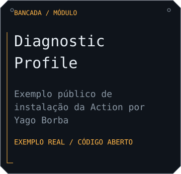
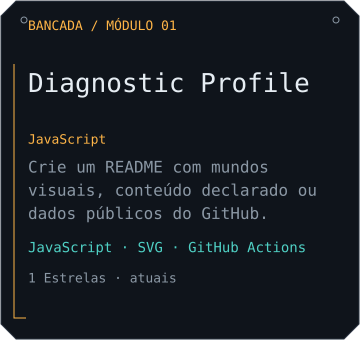
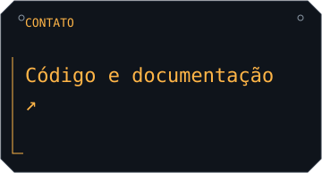

# Diagnostic Profile — instalação pública

Este repositório demonstra o consumo da Action publicada `YagoBorba/diagnostic-profile@v0.2.0` fora do projeto principal. Os SVGs abaixo são gerados com dados públicos de YagoBorba; os textos de apresentação descrevem este exemplo.

<picture>
  <source media="(prefers-color-scheme: dark)" srcset="https://raw.githubusercontent.com/YagoBorba/diagnostic-profile-example/output/header-dark.svg">
  <source media="(prefers-color-scheme: light)" srcset="https://raw.githubusercontent.com/YagoBorba/diagnostic-profile-example/output/header-light.svg">
  
</picture>

## Projetos

<a href="https://github.com/YagoBorba/diagnostic-profile">
<picture>
  <source media="(prefers-color-scheme: dark)" srcset="https://raw.githubusercontent.com/YagoBorba/diagnostic-profile-example/output/project-yagoborba-diagnostic-profile-dark.svg">
  <source media="(prefers-color-scheme: light)" srcset="https://raw.githubusercontent.com/YagoBorba/diagnostic-profile-example/output/project-yagoborba-diagnostic-profile-light.svg">
  
</picture>
</a>

<a href="https://github.com/YagoBorba/diagnostic-profile">
<picture>
  <source media="(prefers-color-scheme: dark)" srcset="https://raw.githubusercontent.com/YagoBorba/diagnostic-profile-example/output/contact-c-digo-e-documenta-o-dark.svg">
  <source media="(prefers-color-scheme: light)" srcset="https://raw.githubusercontent.com/YagoBorba/diagnostic-profile-example/output/contact-c-digo-e-documenta-o-light.svg">
  
</picture>
</a>
<a href="https://github.com/YagoBorba">
<picture>
  <source media="(prefers-color-scheme: dark)" srcset="https://raw.githubusercontent.com/YagoBorba/diagnostic-profile-example/output/contact-yago-borba-dark.svg">
  <source media="(prefers-color-scheme: light)" srcset="https://raw.githubusercontent.com/YagoBorba/diagnostic-profile-example/output/contact-yago-borba-light.svg">
  
</picture>
</a>

<a href="https://github.com/YagoBorba/diagnostic-profile">Diagnostic Profile</a> · <a href="https://github.com/YagoBorba">Yago Borba</a>

## Experimente

1. Abra o [Studio gratuito](https://yagoborba.github.io/diagnostic-profile/).
2. Escolha um mundo, personalize seu conteúdo e exporte o kit estático ou a configuração com Action.
3. Consulte o [guia de instalação](https://github.com/YagoBorba/diagnostic-profile/blob/v0.2.0/docs/GETTING_STARTED.md).

Este exemplo publica somente na branch `output`, com o GITHUB_TOKEN do próprio repositório. Não precisa de PAT nem de serviços de imagens. A atualização é manual por workflow_dispatch ou após alteração da configuração em main; não há agendamento. A CI em PR apenas gera e verifica arquivos, sem publicar.

## Desenvolvimento

Gitflow: feature/* → develop → release/* → main, com merge commits e tags anotadas. A versão deste exemplo é independente da versão da Action. Copie e adapte os arquivos para seu repositório; não edite output manualmente.

Criado por [Yago Borba](https://github.com/YagoBorba) · [Código original](https://github.com/YagoBorba/diagnostic-profile) · MIT.
