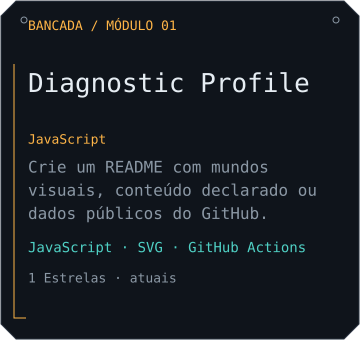

<picture>
  <source media="(prefers-color-scheme: dark)" srcset="https://raw.githubusercontent.com/YagoBorba/diagnostic-profile-example/output/header-dark.svg">
  <source media="(prefers-color-scheme: light)" srcset="https://raw.githubusercontent.com/YagoBorba/diagnostic-profile-example/output/header-light.svg">
  
</picture>

## Projetos

<a href="https://github.com/YagoBorba/diagnostic-profile">
<picture>
  <source media="(prefers-color-scheme: dark)" srcset="https://raw.githubusercontent.com/YagoBorba/diagnostic-profile-example/output/project-yagoborba-diagnostic-profile-dark.svg">
  <source media="(prefers-color-scheme: light)" srcset="https://raw.githubusercontent.com/YagoBorba/diagnostic-profile-example/output/project-yagoborba-diagnostic-profile-light.svg">
  
</picture>
</a>

<a href="https://github.com/YagoBorba/diagnostic-profile">
<picture>
  <source media="(prefers-color-scheme: dark)" srcset="https://raw.githubusercontent.com/YagoBorba/diagnostic-profile-example/output/contact-c-digo-e-documenta-o-dark.svg">
  <source media="(prefers-color-scheme: light)" srcset="https://raw.githubusercontent.com/YagoBorba/diagnostic-profile-example/output/contact-c-digo-e-documenta-o-light.svg">
  
</picture>
</a>
<a href="https://github.com/YagoBorba">
<picture>
  <source media="(prefers-color-scheme: dark)" srcset="https://raw.githubusercontent.com/YagoBorba/diagnostic-profile-example/output/contact-yago-borba-dark.svg">
  <source media="(prefers-color-scheme: light)" srcset="https://raw.githubusercontent.com/YagoBorba/diagnostic-profile-example/output/contact-yago-borba-light.svg">
  
</picture>
</a>

<a href="https://github.com/YagoBorba/diagnostic-profile">Diagnostic Profile</a> · <a href="https://github.com/YagoBorba">Yago Borba</a>
